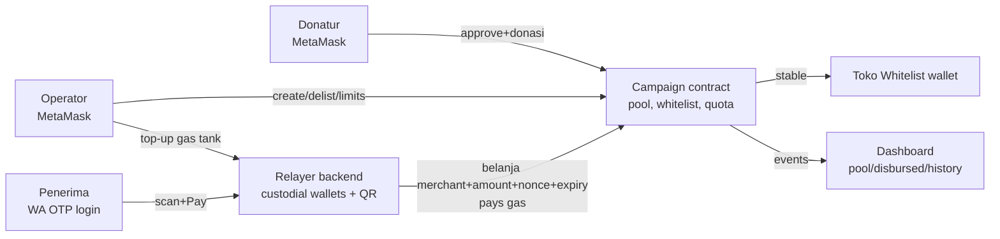

# PRD: Bound (Programmable Donations Spendable Only at Whitelisted Stores)

## 1. Problem
Cash-like aid leaks: once assistance lands as free cash or e-wallet balance in a personal account, nothing constrains where it goes next. In Indonesia, that gap was proven exploited into online gambling (judol). The Kemensos and PPATK matching of 28.4 million recipient NIKs against 9.7 million judol-player NIKs found 571,410 identical NIKs in 2024 (a single state bank alone), with 7.5 million transactions worth Rp957 billion; matched to DTSEN this became 603,999 KPM, rising to 1,494,652 Sembako KPM in 2026 (794,475 also PKH recipients). Average deposits sit around Rp1.9 million per person over rails of DANA e-wallets, QRIS deposits, and digital/private banks, with one Rp2.68 billion anomaly still under investigation into whether a bansos account was even used.

The 2026 data clarifies who acts: roughly 90 percent of flagged accounts are not operated by the registered payee but by same-KK family members: over 1 million children, about 458 thousand heads of household/husbands, 40 thousand wives, 23 thousand grandchildren, plus 10 thousand-plus poor residents' ID cards suspected of misuse by others (lent, proxied, phished). "Indicated" is not a verdict: 21 thousand recipients were reactivated after prior-period verification and tens of thousands more cleared clarification via the Cek Bansos app and village SIKS-NG operators. The state response stays punitive and post-hoc: match NIK, suspend, remove 228,048 KPM in Q2-2025, reallocate to more deserving desils, with no mechanism stopping deviant spending at the transaction point.

The core gap is not data but programmability: money that can go anywhere will go anywhere. The bansos-judol evidence above is the problem validation; the MVP wedge below is not government desil aid (which needs DTSEN/NIK rails) but recovery-phase disaster crowdfunding, where the same leak (free cash forwarded to gambling instead of spent on recovery) applies without state integration.

## 2. Solution 
This platform is a public fundraising system for the disaster-recovery phase (weeks to months after the event, when warungs have reopened and communal kitchens have closed; it does not cover the acute 0 to 72h phase, which needs ready-made goods like fast food, clothes, and medicine via physical posko outside this system). Donations become non-transferable spending rights redeemable only at whitelisted stores. Anyone can donate to a Campaign pool. Only listed recipients can spend, only at listed stores, up to a per-recipient quota, via a dynamic QR checkout with sponsored gas. There is no free-transfer path by design: no send-to-friend, no cash-out to gambling. All donations, spending, and whitelist changes are on-chain and publicly auditable.

## 3. Users
Canonical terms from `CONTEXT.md` (use these in the proposal, avoid synonyms):

- **Kampanye (Campaign):** a single fundraising drive with its own recipient list, store whitelist, and quota. Example: "Banjir Demak 2025". Avoid: campaign, bansos.
- **Donatur (Donor):** anyone who donates to a Campaign pool. Permissionless. Avoid: donor.
- **Penerima (Recipient):** a person granted spending rights in a Campaign, not free cash. Allowlisted by the operator. Avoid: beneficiary, KPM.
- **Hak Belanja (Spending right):** a non-transferable balance owned by a Penerima, spendable only via whitelisted checkout. Avoid: balance, token, voucher.
- **Toko Whitelist (Whitelisted store):** a store approved in a Campaign to receive Hak Belanja and settle funds. Registered by the operator as `name + address`. Avoid: merchant, vendor.

| Role | Onboarding (MVP) | Wallet | Gas |
|---|---|---|---|
| Operator (Campaign creator) | Creates Campaign in the app, registers whitelist first, then recipients | Self-custodial (MetaMask on testnet) | Pays own txs + tops up relayer gas tank |
| Donatur | Chooses at the donation page: (a) "I have a wallet": connects own wallet and donates; (b) "I don't have a wallet": logs in with OTP, gets an auto-created embedded wallet, funds it, donates in-app | (a) Self-custodial (e.g. MetaMask); (b) custodial embedded (no seed) | Pays own donation tx in both paths (default) |
| Penerima | Auto-created from operator's list; logs into this platform using a phone number and a WhatsApp OTP code | Custodial embedded wallet, no seed shown | Sponsored by relayer (pays 0) |
| Toko Whitelist | Registered by the operator; 1 address per store | EOA / 1-click embedded | Receives only |

Why custodial recipients: the target population uses DANA-like e-wallets, not seed phrases. Decentralization is kept where it matters, spend rules and audit trail on-chain, not as seed-phrase burden on recipients. Donors get both paths (own wallet for crypto-aware judges/testers; embedded for the general public), but both donate the same Campaign token and need funding exactly once before the first donation. No fiat on-ramp or in-app swap widget in MVP.

## 4. End-to-end application flow 
Whitelist is registered before recipients (operator decision order).

1. Operator connects their own wallet (e.g. MetaMask on Base Sepolia) to this platform and opens "Create Campaign".
2. Operator fills Campaign parameters: name, `jatahPerPenerima` (e.g. IDR 500,000), limits (e.g. max 200,000/tx, 500,000/day), and metadata.
3. Operator registers the Toko Whitelist first: for each store, the operator enters the store name and the store's wallet address (provided by the store via one MetaMask click or a 10-second embedded wallet). This platform stores `isWhitelist[address] = true` on-chain. Example: "Sumber Rejeki: 0xWarung1".
4. Operator registers Penerima second: for each recipient, the operator enters the name and WhatsApp number (`nama,WA` per line). This platform automatically creates one custodial wallet per WA number and marks `isPenerima[address] = true` on-chain. No action is required from recipients before day one.
5. Operator deploys the Campaign via the factory contract and tops up only the relayer gas tank (a small backend wallet pre-filled with free testnet ETH, e.g. 0.01 Sepolia-ETH covers hundreds of checkouts). Donation pool money comes from Donatur, never from the operator.
6. Donatur opens the Campaign donation page and chooses one path (both end in the same `donasi()` to the shared pool; the donor never selects a person). (a) "I have a wallet": the donor connects their own wallet (e.g. MetaMask), gets mock stable from the faucet (1 token = IDR 1 convention), approves, and calls `donasi()`. (b) "I don't have a wallet": the donor logs into this platform using a phone number/email and an OTP code, this platform auto-creates one embedded wallet and shows its `0x...` address, the donor funds that wallet exactly once (faucet, transfer from a friend, or withdrawal from an exchange such as Binance/OKX/Indodax on the Base network to that address), then approves and donates inside the app. No in-app swap widget and no fiat/QRIS gateway in MVP.
7. Penerima opens this platform on an Android phone and logs in using their phone number and a WhatsApp OTP code (hackathon uses static code `123456`; production uses a real OTP provider). On success, this platform shows their spendable amount.
8. A Toko Whitelist cashier opens "Create QR", types the bill amount (e.g. IDR 50,000), and this platform generates a dynamic QR containing `{campaign, merchant, amount, 5-minute expiry, one-time nonce}` displayed on the store device.
9. Penerima taps Scan, points the phone camera at the store QR, reviews amount + store name, and taps Pay. The custodial backend verifies recipient, whitelist, quota, pool, expiry, and nonce, then submits `belanja()` on-chain and pays the gas. The recipient never sees seed phrases or gas prompts.
10. The contract settles instantly: stable moves Campaign → store wallet; `sudahBelanja[recipient]`, daily counter, pool, and used-nonce update; events are emitted. The store sees funds in its wallet; the recipient sees the new remaining amount.
11. Anyone (including judges) opens the Campaign dashboard: pool collected vs target, total disbursed, whitelist with delist buttons, and full spend history read from chain events.
12. Operator enforces: a rogue store is delisted in one click (next checkout there reverts); limits cap blast radius; the pool refills with each new donation.

## 5. Business rules
| ID | Rule | Failure |
|---|---|---|
| BR-01 | Only `isPenerima` addresses can spend; recipients come only from the operator list | `BUKAN_PENERIMA` |
| BR-02 | Only `isWhitelist` stores can receive; whitelist is set before recipients and editable only by the operator | `BUKAN_WHITELIST` |
| BR-03 | Spendable per recipient is `min(jatah − sudahBelanja, poolRemaining)` | `JATAH_HABIS` / `POOL_HABIS` |
| BR-04 | Single checkout ≤ `maxPerTx` (e.g. 200,000) | `LIMIT` |
| BR-05 | Daily total per recipient ≤ `maxPerHari` (e.g. 500,000) | `LIMIT` |
| BR-06 | QR expires 5 minutes after creation | `EXPIRED` |
| BR-07 | Each QR nonce is single-use | `NONCE_DIGUNAKAN` |
| BR-08 | No transfer function exists; the only fund-moving paths are `donasi()` in and `belanja()` out | By construction (no UI path) |
| BR-09 | Delisting is immediate; in-flight QRs to a delisted store fail | `BUKAN_WHITELIST` |
| BR-10 | Gas: donor pays own donation tx in both donor paths (own wallet and embedded; default); recipient pays 0 (relayer/operator pays `belanja()` gas); dashboard reads are free | Wallet UX |
| BR-11 | One human can hold several WA slots if the operator lists them (Sybil). MVP trusts operator curation; NIK/biometric dedup is day-2 | Docs note |
| BR-12 | Pool money (donor-funded) and gas tank (operator-funded) are separate; donation volume does not raise operator top-ups. Checkout count does. | Ops note |

## 6. Tech stack  + architecture
Stack: Solidity (MockIDRX ERC20 faucet, CampaignFactory, Campaign) deployed via Remix to Base Sepolia testnet; backend relayer in Node.js + ethers (WA-OTP mock, WA→wallet map, QR nonce/expiry, sponsored-gas submitter); frontend in Next.js + wagmi/viem + QR libs (`qrcode.react`, scanner with manual-paste fallback), mobile-first. Next.js is chosen because the team needs one reliable web framework for four simple pages. No mobile native, no indexer, no AA paymaster, no IPFS in MVP.

## 7. What "anti-judol" means here (honest scope)
- **Prevented by design:** free transfers to friends, family forwarding (the 98.5%-kin pattern), QRIS gambling deposits, P2P collusion via transferable tokens have no on-chain path, because no transfer function exists.
- **Not 100% prevented in MVP:** physical cash-collusion (fake purchase → cash back → gambling). Mitigation: everything on-chain (anomalous patterns visible), per-tx/daily limits, instant delist.
- **Day-2, explicitly out of MVP:** photo/struk upload, goods oracles, human verifiers.

This framing is judge-safe: raising the cost of cheating from zero to "must collude and gets caught" instead of claiming impossibility.

## 8. Target market / users
- **Primary: disaster-recovery crowdfunding (recovery phase only).** Operators: NGOs, campus/CSR teams, community orgs running "Banjir Demak"-style drives after warungs reopen. Donors: general public (crypto-aware for MVP). Recipients: affected families with Android + WA in signal areas. Stores: reopened local warungs/posko suppliers onboarded as whitelist. Why first: same spendable-money flow as aid, no government integration, emotionally legible to judges, 5-minute demo. Acute-phase victims (0 to 72h, needing ready-made goods via physical posko) are explicitly not served by this system.
- **Secondary: scholarships.** Operators: campuses/foundations. Recipients: students (phone-native). Stores: bookstores, course providers, campus cashiers. Same contract, different whitelist; "beasiswa cair jadi nongkrong" becomes the failure mode prevented.
- **Day-2 (roadmap, not demo): routine desil-targeted government-style aid (PKH/BPNT-like).** Same programmable-money pattern, but requires DTSEN/NIK rails, Himbara/Pos disbursement, and real-IDRX settlement, which is out of hackathon scope.
- **Explicit non-targets (MVP):** acute-phase victims needing goods (served by posko logistics), elderly/disabled/off-grid recipients served today by Pos Indonesia door-to-door cash; anyone without a phone or signal; government DTSEN/NIK rails. Stated plainly so the proposal does not overclaim.

## 9. MVP demo script (5 minutes)
Campaign "Banjir Demak: 100 × @500K", 2 demo stores, 3 demo recipients (Ani/Budi/Citra):
1. Faucet + donate IDR 10M via own-wallet path → pool 10,000,000. (Embedded donor path exists as fallback: OTP login → auto wallet → fund → donate; same pool.)
2. Ani (quota 500K, spent 0) scans dynamic QR 50K → success → store +50K, Ani spent 50K, pool 9,950,000, history appears.
3. Negative 1: no send-to-friend path exists in UI or contract.
4. Negative 2: yesterday's QR (expired) → revert `EXPIRED`. Random outsider scans → revert `BUKAN_PENERIMA`.
5. Operator delists rogue store → next checkout there reverts `BUKAN_WHITELIST`; dashboard updates.

## 10. Success metrics 
- Functional: donation→pool→redemption completes on testnet; scan→confirmation <30s.
- Security story: 0 free-transfer paths (contract + UI); 100% of spends and whitelist edits emitted as events.
- Product: recipient checkout needs no seed/gas knowledge (phone + WhatsApp OTP → scan → pay).
- Transparency: any judge can read pool, disbursed, whitelist, and history from chain.

## 11. Out of scope 
Real-money stablecoins (uses mock IDR stable on Base Sepolia testnet), automatic bank/DANA off-ramp for stores, QRIS/bank/e-wallet fiat on-ramp for donors (donors fund wallets via faucet/transfer/CEX withdrawal only), in-app swap widget, single-token rule exceptions, NIK/DTSEN/government integration, donor-chooses-recipient personalization, DAO voting on whitelist, receipt/IPFS proofs, audit-grade security. Testnet demo only. Do not present as mainnet-ready.

Production/mainnet note: the Campaign token is IDRX, single denomination per Campaign. Every donor, whether domestic or foreign and holding ETH/USDC/other coins, must swap first into IDRX (manually on a DEX or via a third-party exchange withdrawal on the Base network) before `donasi()`; the contract performs no automatic conversion.

Mock-token note for judges: the mock is ~10 lines of standard ERC20 for faucet convenience, not a new coin or DeFi protocol. Production swaps the token address to IDRX; Campaign logic is unchanged.

## 12. Appendix (do not duplicate)
- Specs: `SPEC-contracts.md`, `SPEC-relayer.md`, `SPEC-web.md` at project root (module specs supersede the single build spec; index: `CAPABILITY_MAP.md`)
- Language: `CONTEXT.md`
- Intent: `docs/intent/hackathon-demo.md`
- Tracker: `docs/agents/issue-tracker.md`: implementation tickets go to `.scratch/bound-mvp/issues/NN-slug.md`
- Domain rules: `docs/agents/domain.md`
